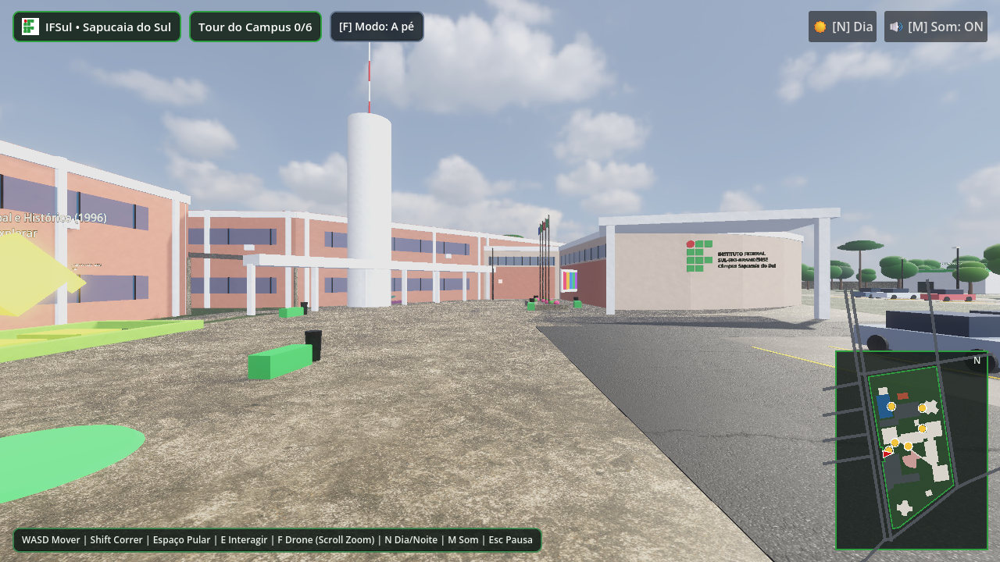
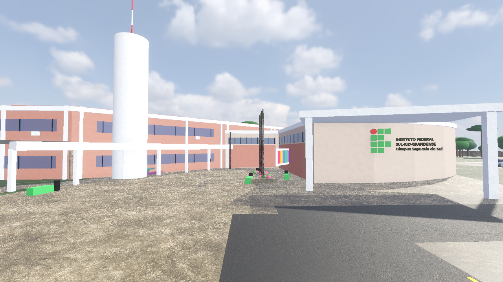
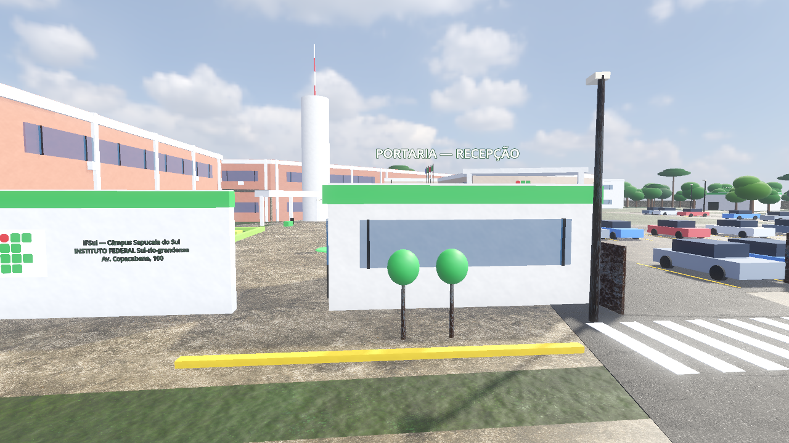
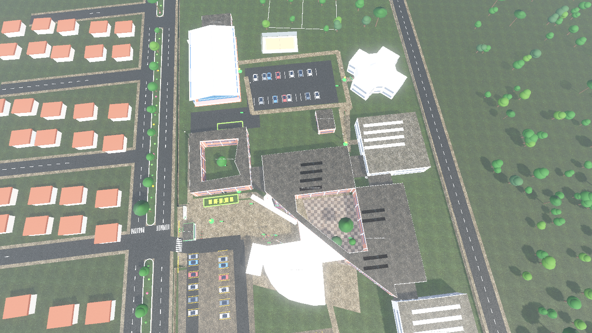
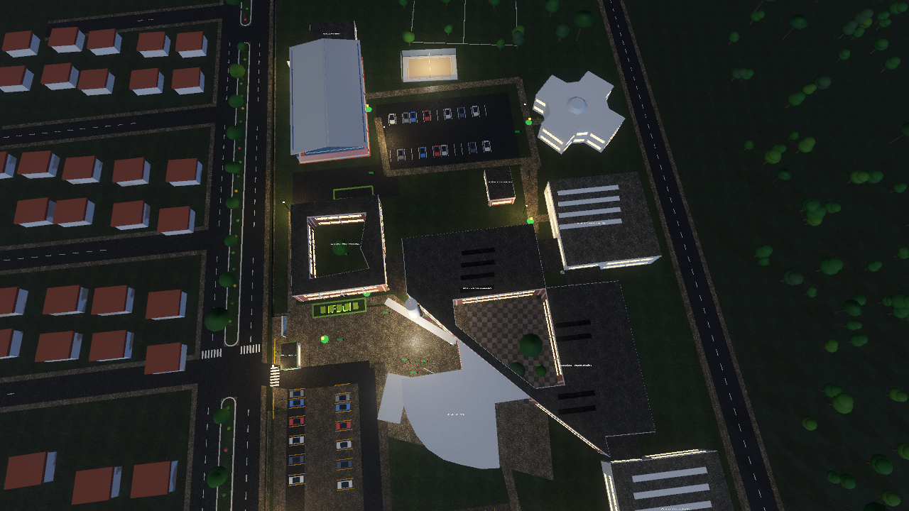
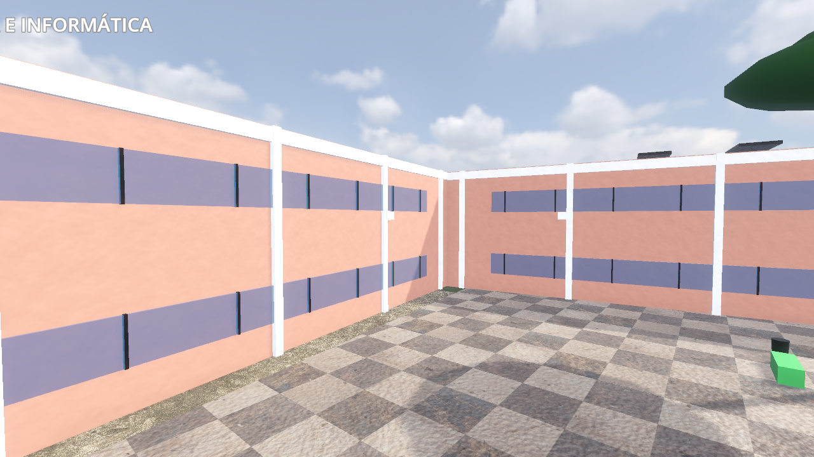
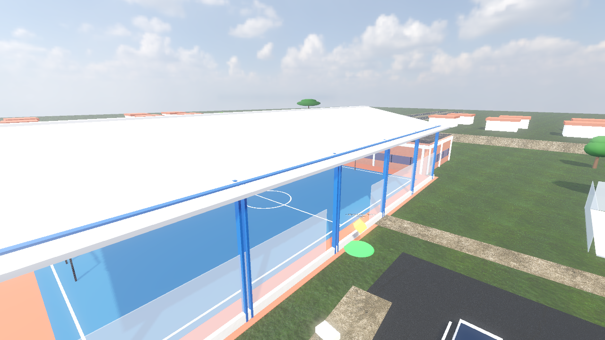
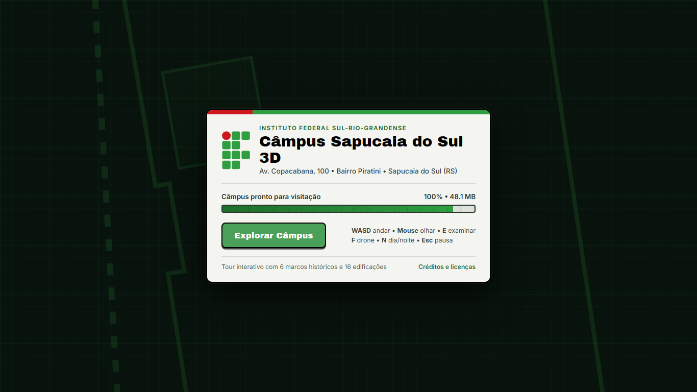
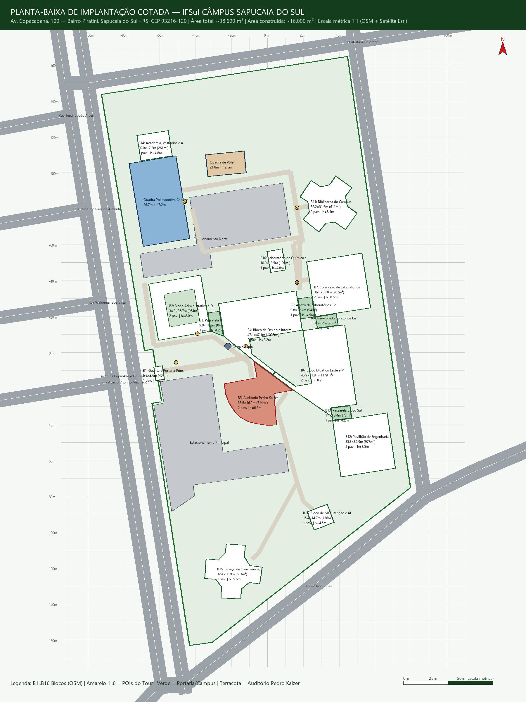

<div align="center">

# 🏛️ IFSul — Câmpus Sapucaia do Sul 3D

**Gêmeo Digital e Exploração Interativa 3D em Escala Métrica 1:1**  
*Instituto Federal de Educação, Ciência e Tecnologia Sul-rio-grandense (RS)*

[](https://godotengine.org/)
[](#como-executar)
[](site/server.js)
[](https://www.openstreetmap.org/way/333342533)
[](LICENSE)

[Visão Geral](#-visão-geral) •
[Galeria](#-galeria-visual) •
[Tour Guiado (POIs)](#-tour-guiado--6-pontos-de-interesse) •
[Controles](#-controles) •
[Como Executar](#-como-executar) •
[Arquitetura](#-arquitetura-e-destaques-técnicos) •
[Estrutura](#-estrutura-do-repositório) •
[Créditos](#-documentação-e-créditos)

</div>

---



## 📖 Visão Geral

**IFSul — Câmpus Sapucaia do Sul 3D** é uma reconstrução tridimensional interativa e georreferenciada do primeiro câmpus do Instituto Federal Sul-rio-grandense estabelecido fora de Pelotas (inaugurado em 1996 na **Av. Copacabana, 100 — Bairro Piratini, Sapucaia do Sul/RS**).

O ambiente virtual reconstrói os **38.600 m²** do terreno (~16.000 m² de área construída) em **escala métrica real (1:1)** a partir de polígonos cartográficos do **OpenStreetMap (`way/333342533`)**, ortofotos de satélite e fotografias históricas do **Acervo Memórias IFSul**. O projeto pode ser executado tanto nativamente no desktop via **Godot Engine 4** quanto diretamente no navegador via **WebAssembly / WebGL 2.0**.

### Principais Recursos

- 🗺️ **Implantação Georreferenciada 1:1:** 16 edificações reais, passarelas cobertas, guarita, caixa d'água cilíndrica, complexo esportivo, estacionamentos, lago sul, topiaria institucional e malha viária do entorno (Av. Copacabana em pista dupla com canteiro central vegetado).
- 🎓 **Tour Guiado Interativo (6/6 POIs):** Marcos históricos, acadêmicos, laboratoriais e esportivos com painéis informativos e rastreamento de progresso no HUD e minimapa.
- 🚁 **Modo A Pé (FPS) e Câmera Drone:** Alterne livremente entre a caminhada em primeira pessoa com áudio espacial de passos/ambiente e o sobrevoo panorâmico do câmpus.
- 🌗 **Ciclo Dia e Noite Dinâmico:** Iluminação diurna com HDRI 1K CC0, SSAO e sombras direcionais nítidas, além de modo noturno com janelas emissivas e refletores nas quadras, fachada e jardins.
- 🌐 **Shell Web de Alta Performance:** Interface web customizada inspirada na sinalização arquitetônica da Rede Federal, com barra de progresso real, pré-compressão **Brotli (`.br`)** e **Gzip (`.gz`)**, seleção de qualidade gráfica e suporte a deploy imediato no **Render.com**.

---

## 📸 Galeria Visual

| Fachada Principal e Auditório Pedro Kaizer | Portaria Principal (Av. Copacabana, 100) |
| :---: | :---: |
|  |  |
| **Vista Aérea Diurna (Implantação 1:1)** | **Vista Aérea Noturna (Iluminação Emissiva)** |
|  |  |
| **Pátio Central e Blocos Acadêmicos** | **Complexo Esportivo e Quadra Poliesportiva** |
|  |  |
| **Interface Web (Placa Institucional de Entrada)** | **Planta-Baixa Técnica Cotada (Escala 1:1)** |
|  |  |

---

## 📍 Tour Guiado — 6 Pontos de Interesse

Durante a exploração, aproxime-se dos marcos sinalizados no câmpus (e destacados no minimapa) e pressione **`E`** para inspecionar cada ponto histórico:

| # | Ponto de Interesse (POI) | Localização no Câmpus | Destaque Histórico e Institucional |
| :-: | :--- | :--- | :--- |
| **1** | **Portaria Principal e Histórico (1996)** | Acesso Oeste (`Av. Copacabana`) | Fundação como UNED da ETF-Pelotas (1996), transição para CEFET-RS (1999) e IFSul (2008). |
| **2** | **Bloco Administrativo e Auditório Pedro Kaizer** | Eixo Frontal Sudoeste | Direção-Geral, registros acadêmicos, pórtico curvo com relevo 3D IFSul e auditório para 300 lugares. |
| **3** | **Ensino, Salas de Aula e Cursos Ofertados** | Pátio Central / Bloco Didático | 18 salas climatizadas; cursos Técnicos (Mecânica, Plásticos, Informática, DS, Eventos), Graduações e Pós. |
| **4** | **Complexo de Laboratórios Industriais** | Pavilhões Leste | Usinagem CNC, soldagem, metrologia, hidráulica, transformação de plásticos (extrusão/injeção) e Lab STEAM. |
| **5** | **Biblioteca do Câmpus** | Edificação Norte em Cruz | Prédio próprio inaugurado em 2014 (>580 m²) com salão de leitura, cabines de estudo e infanteca. |
| **6** | **Complexo Esportivo e Convivência** | Setor Noroeste | Quadra poliesportiva coberta em estrutura metálica azul, quadra de vôlei de areia, academia e vivência. |

---

## 🎮 Controles

| Tecla / Entrada | Ação |
| :--- | :--- |
| `W` `A` `S` `D` ou `Setas` | Movimentar pelo câmpus |
| `Mouse` | Olhar ao redor (rotação de câmera) |
| `Shift` | Correr (sprint) |
| `Espaço` | Pular (modo a pé) / Subir (modo drone) |
| `Ctrl` | Descer (modo drone) |
| `Scroll do Mouse` | Ajustar zoom / velocidade no modo drone |
| `E` | Examinar Ponto de Interesse (POI) próximo |
| `F` | Alternar entre **Modo A Pé (FPS)** e **Câmera Drone** |
| `N` | Alternar ciclo **Dia / Noite** |
| `M` | Ativar / Desativar som ambiente e efeitos |
| `Esc` | Abrir menu de pausa / liberar cursor do mouse |

---

## 🚀 Como Executar

### 1. Executar no Navegador (Servidor Web Local)

O repositório já inclui o pacote WebGL2 pré-compilado e comprimido em `site/public/game/`. Para iniciar o servidor Express localmente:

```bash
# Instalar dependências (Node.js 18+)
npm install

# Iniciar o servidor em http://localhost:3000
npm start
```

Abra **`http://localhost:3000`** em qualquer navegador moderno com suporte a WebGL 2.0.

### 2. Executar Nativamente no Godot Engine (Desktop)

Requer **Godot Engine 4.x** (testado na versão `4.7-stable`):

```bash
# Abrir diretamente o câmpus jogável
godot --path .

# Ou abrir o projeto no editor da Godot
godot --editor --path .
```

### 3. Build Web, Captura e Testes Automatizados (QA)

```bash
# Recompilar o export Web (.wasm + .pck) e gerar pré-compressão Brotli/Gzip
npm run build:web

# Executar suíte E2E automatizada no navegador (Playwright)
npm run test:web

# Executar verificação de QA física/lógica headless no Godot
godot --headless --path . -s tools/qa_verify.gd
```

### 4. Deploy em Nuvem (Render.com)

O arquivo [`render.yaml`](render.yaml) configura o deploy contínuo via **Render Blueprint**:
1. Conecte este repositório no painel do [Render.com](https://render.com) via **New Blueprint**.
2. O serviço utiliza `npm ci --omit=dev` no build, `node site/server.js` na inicialização e monitoramento automático na rota `/healthz`.

---

## 🏗️ Arquitetura e Destaques Técnicos

- **Geração Procedural Baseada em Dados (`scripts/campus_builder.gd`):** Lê as coordenadas métricas de [`data/campus.json`](data/campus.json) e constrói em tempo de carga todas as 16 edificações com alvenaria terracota, pilares/vigas brancas, janelas com montantes verticais, condensadoras de ar-condicionado, claraboias industriais e cúpula central na Biblioteca.
- **Instanciação por Hardware (`MultiMeshInstance3D`):** Árvores multi-camada (incluindo Araucárias típicas do sul), arbustos, veículos em 3 partes nos estacionamentos, postes de iluminação e residências do bairro vizinho são agrupados em `MultiMesh` para manter o *frametime* próximo de ~7.4 ms em 1080p/720p.
- **Materiais PBR + Fallbacks Procedurais (`scripts/materials.gd`):** Utiliza texturas PBR CC0 (asfalto, concreto, grama, piso cerâmico e metal) combinadas com geração procedural em código da marca oficial do IFSul e sinalizações, garantindo funcionamento **100% offline**.
- **Servidor Web Otimizado (`site/server.js`):** Serve assets versionados por hash SHA-256 (`ifsul.<hash>.wasm`, `.pck`, `.js`) com cabeçalhos `Cache-Control: immutable` e entrega diretamente os binários `.br` (Brotli) ou `.gz` (Gzip) negociados via `Accept-Encoding`.

---

## 📂 Estrutura do Repositório

```text
ifsul-sapucaia-3d/
├── assets/
│   ├── audio/                  # Áudio espacial procedural (vento, pássaros, passos)
│   ├── hdri/                   # Skybox HDRI 1K CC0 (Poly Haven)
│   ├── textures/               # Texturas PBR 1K CC0 (asfalto, concreto, grama, piso, metal)
│   └── ref/                    # Acervo fotográfico de referência e plantas-baixas 1:1
├── data/
│   ├── campus.json             # Polígonos georreferenciados (OSM), prédios, ruas e 6 POIs
│   └── shots.json              # Câmeras padronizadas para regressão visual
├── docs/
│   ├── screenshots/            # Capturas de tela em alta definição do projeto
│   ├── BACKLOG.md              # Histórico de prioridades e melhorias de fidelidade
│   ├── CREDITS.md              # Créditos detalhados e licenças de todos os recursos
│   ├── ITERATIONS.md           # Log de evolução visual (iter-01 a iter-13) e métricas
│   └── REFERENCES.md           # Fontes institucionais, históricas e cartográficas
├── scenes/
│   ├── main.tscn               # Cena principal 3D do câmpus
│   ├── player.tscn             # Controlador FPS + Câmera Drone
│   └── hud.tscn                # Interface de usuário, modais de POI e minimapa
├── scripts/
│   ├── campus_builder.gd       # Construtor procedural 3D do câmpus e entorno urbano
│   ├── main.gd                 # Ciclo dia/noite, áudio, estado do tour e ponte JS/Web
│   ├── materials.gd            # Materiais PBR, shaders e geração vetorial de placas/logos
│   ├── player.gd               # Física de movimentação a pé e voo livre (drone)
│   ├── hud.gd                  # Gerenciamento de HUD, modais e atalhos
│   └── minimap.gd              # Renderização 2D em tempo real do mapa do câmpus
├── site/
│   ├── server.js               # Servidor Express com suporte a Brotli/Gzip e /healthz
│   └── public/                 # Shell HTML5/CSS3, fontes OFL e pacote WebGL2 compilado
├── tools/
│   ├── build_web.sh            # Pipeline de exportação Web + auditoria .pck + compressão
│   ├── web_smoke.mjs           # Testes E2E automatizados com Playwright
│   ├── qa_verify.gd            # Suite de testes funcionais e de colisão no Godot
│   ├── capture.gd / capture.sh # Automação de capturas e benchmark de frametime
│   ├── generate_planta_baixa.py# Gerador da planta-baixa técnica cotada (SVG/PNG)
│   └── fetch_assets.sh         # Script reprodutível para download de texturas CC0
├── export_presets.cfg          # Configuração de exportação Web (Godot 4)
├── project.godot               # Configuração principal do projeto Godot 4
├── package.json                # Scripts NPM e dependências do servidor/testes web
├── render.yaml                 # Blueprint de deploy para Render.com
└── LICENSE                     # Licença MIT (código) e notas de licenciamento de assets
```

---

## 📚 Documentação e Créditos

- **[Créditos e Licenças dos Assets (`docs/CREDITS.md`)](docs/CREDITS.md):** Relação completa de texturas PBR e HDRI (Poly Haven — **CC0 1.0**), dados geoespaciais (OpenStreetMap — **ODbL 1.0**), fontes tipográficas (Archivo Black e Inter — **SIL OFL 1.1**) e identidade visual institucional.
- **[Referências Oficiais e Cartográficas (`docs/REFERENCES.md`)](docs/REFERENCES.md):** Links para dados oficiais do IFSul Câmpus Sapucaia do Sul, OpenStreetMap e acervo fotográfico.
- **[Índice do Acervo de Referências (`assets/ref/INDEX_REFERENCIAS.md`)](assets/ref/INDEX_REFERENCIAS.md):** Catálogo das plantas-baixas técnicas cotadas, ortofotos e registros históricos utilizados na modelagem.
- **[Log de Iterações Visuais (`docs/ITERATIONS.md`)](docs/ITERATIONS.md):** Registro técnico das 13 iterações de fidelidade arquitetônica e desempenho.

---

## 📄 Licença

O código-fonte deste projeto é distribuído sob a licença **[MIT](LICENSE)**.  
Os recursos gráficos, sonoros, tipográficos e geoespaciais seguem suas respectivas licenças abertas (**CC0 1.0**, **ODbL 1.0** e **SIL OFL 1.1**), conforme detalhado em [`docs/CREDITS.md`](docs/CREDITS.md).
