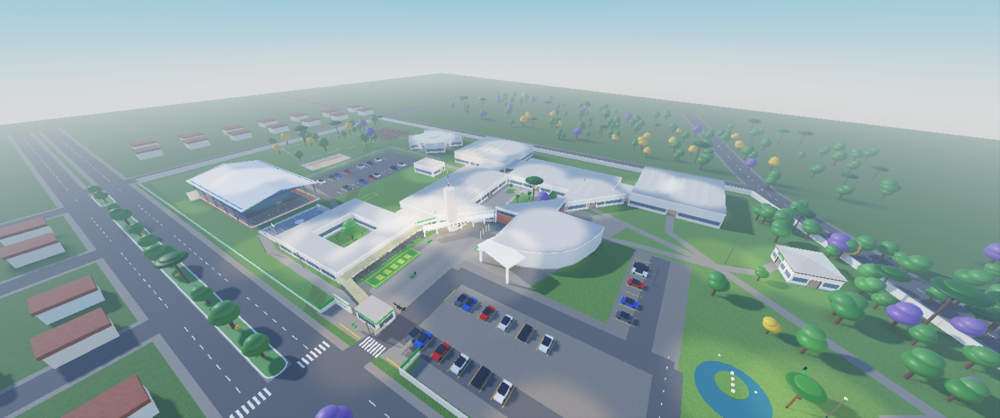
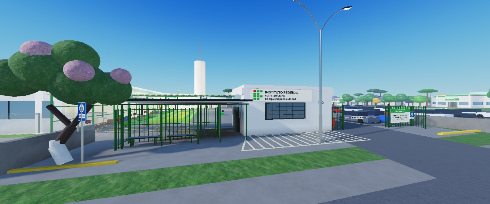
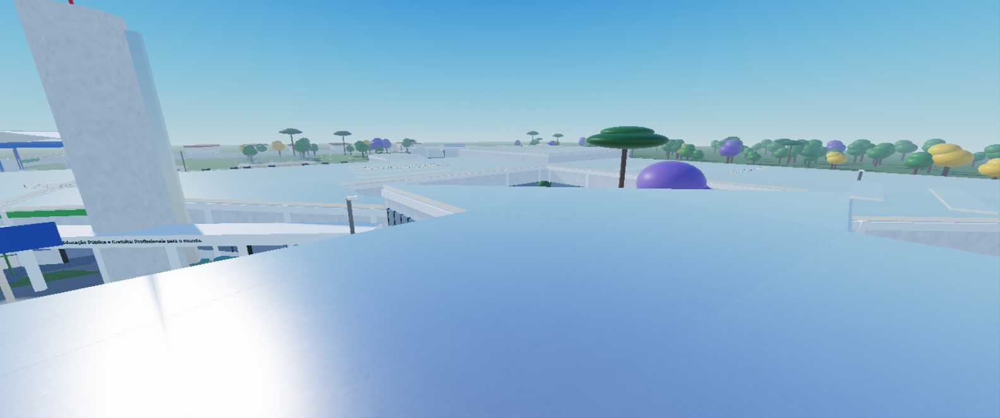

<div align="center">

# 🏛️ IFSul — Câmpus Sapucaia do Sul 3D (Roblox)

**Gêmeo Digital e Exploração Interativa 3D em Escala Métrica 1:1 no Roblox Studio**  
*Instituto Federal de Educação, Ciência e Tecnologia Sul-rio-grandense (RS)*

[](https://create.roblox.com/)
[](https://luau.org/)
[](https://www.openstreetmap.org/way/333342533)
[](LICENSE)

</div>

---



## 📖 Visão Geral

**IFSul — Câmpus Sapucaia do Sul 3D** é uma reconstrução tridimensional interativa e georreferenciada do câmpus localizado na **Av. Copacabana, 100 — Bairro Piratini, Sapucaia do Sul/RS**, construída para **Roblox Studio** em **escala métrica real 1:1** (`1 stud = 0,28 m`).

O projeto reproduz os **38.600 m²** do terreno (~16.000 m² construídos) a partir do **OpenStreetMap (`way/333342533`)**, **ortofoto aérea** e **Mapa Oficial das Salas (DEPEN Sapucaia)**, com:

- 🏛️ **16 edificações reais** em escala 1:1 (portas de `2,1 m = 7,5 studs`, pé-direito de `4,8 m = 17,14 studs`), logo 3D institucional, caixa d'água, ginásio coberto, quadras esportivas, lago dos patos, estacionamentos e Av. Copacabana.
- 🚪 **92 salas e ambientes internos mobiliados** e navegáveis a pé por todos os setores (`Setores 100–500`, `Bloco 800`, `Biblioteca`, `Sede Social` e `Educação Física`).
- 🧭 **HUD Institucional em Luau:** detecção em tempo real da sala onde o jogador está, **Buscador de Salas e POIs (`[G]`)** com teleporte validado no servidor e alternância **Dia / Noite (`[N]`)**.
- 🧟 **Modo Sobrevivência em Ondas (1 a 6 Jogadores):** portal cooperativo na Portaria Principal (`ReserveServer`), hordas R15 invadindo pelas 4 ruas externas, sorteio *roguelite* de **3 Cartas de Habilidade** por onda, **Nova Loja de Upgrades na tela** (com armas oficiais evolutivas em 3 níveis e torretas) e **Missões Bônus** nos setores reais do câmpus.
- 🤖 **Arquitetura preparada para agentes de IA:** manifesto padrão `default.project.json` (compatível com Rojo), dados desacoplados em `data/*.json`, script de sincronização automática `tools/sync_campus_data.py` e manual operacional completo em [`AGENTS.md`](AGENTS.md).

---

## 📸 Galeria (Roblox Studio)

| Entrada Principal e Fachada do Auditório | Pátio Interno e Vegetação (Ipês e Araucárias) |
| :---: | :---: |
|  |  |

---

## 🎮 Controles no Roblox

| Tecla / Entrada | Ação |
| :--- | :--- |
| `W` `A` `S` `D` / `Espaço` | Movimentação padrão do avatar Roblox pelo câmpus e interiores |
| `G` | Abrir **Buscador de Salas & POIs** (busca por número, nome ou apelido + teleporte) |
| `N` | Alternar ciclo **Dia / Noite** (ativa iluminação dos postes e interiores) |
| `Esc` | Fechar o buscador de salas |

---

## 📂 Estrutura do Repositório

```text
ifsul-sapucaia-3d/
├── default.project.json            # Mapeamento src/ -> Serviços do Roblox (compatível com Rojo)
├── AGENTS.md                       # Guia técnico e fluxo MCP para manutenção por agentes de IA
├── data/
│   ├── campus.json                 # Polígonos georreferenciados (OSM), 16 blocos, quadras e 8 POIs
│   ├── interiors.json              # Catálogo espacial das 92 salas, 10 setores e sinalização
│   ├── shots.json                  # Câmeras padronizadas para verificação visual
│   ├── campus_geometry.zst.b64     # Snapshot binário Zstd+Base64 (10.565 Parts, 112 Signs, 34 Lights)
│   └── city/<cidade>/              # Tiles binários IFC2 (500 m) e index.json da malha urbana externa
├── src/
│   ├── shared/                     # ReplicatedStorage.IFSul
│   │   ├── Config.luau             # Escala métrica, paleta IFSul e presets de iluminação
│   │   ├── CityStyle.luau          # Constantes de streaming e materiais da expansão urbana
│   │   └── CampusData.luau         # Catálogo tipado (gerado por tools/sync_campus_data.py)
│   ├── server/                     # ServerScriptService.IFSul
│   │   ├── CampusBuilder.luau      # Construtor do mapa a partir do snapshot binário Zstd
│   │   ├── CityTileCodec.luau      # Decodificador de tiles urbanos IFC2 em lotes
│   │   ├── CityLoader.server.luau  # Carregamento por raio dos tiles em Workspace.IFSul_City
│   │   └── CampusServer.server.luau# Controle de Dia/Noite e teleporte validado no servidor
│   └── client/                     # StarterPlayerScripts.IFSul
│       └── CampusHUD.client.luau   # HUD, detector de sala atual e buscador [G]
├── tools/
│   ├── sync_campus_data.py         # Gera src/shared/CampusData.luau a partir de data/*.json
│   ├── generate_planta_baixa.py    # Gera planta-baixa técnica cotada em SVG/PNG
│   └── city/                       # Pipeline Overture Maps -> tiles IFC2 (build_city.py)
├── assets/ref/                     # Plantas oficiais (DEPEN), ortofoto e OSM (referência)
└── docs/                           # Screenshots do Roblox Studio, backlog, créditos e referências
```

---

## 🚀 Como Trabalhar no Projeto

### Via Roblox Studio MCP (com Agente de IA)
1. Abra o **Roblox Studio** com o servidor MCP `Roblox_Studio` ativo.
2. O agente usa [`AGENTS.md`](AGENTS.md) para sincronizar `src/` com o Studio, reconstruir o mapa via `CampusBuilder` (se necessário) e validar alterações com `screen_capture` e `start_stop_play`.

### Via Rojo (opcional)
```bash
rojo serve default.project.json
```
Conecte o plugin **Rojo** no Roblox Studio para sincronizar automaticamente `src/shared`, `src/server` e `src/client`.

### Atualizando Dados do Câmpus
Sempre que editar `data/campus.json` ou `data/interiors.json`, regere o módulo Luau tipado:
```bash
python tools/sync_campus_data.py
```

### Gerando Malha Viária e Edifícios das Cidades
Para gerar tiles binários (`IFC2`) de ruas e fachadas em escala 1:1 para **Sapucaia do Sul**, **São Leopoldo** e **Portão** a partir do Overture Maps:
```bash
python -m tools.city.build_city --city sapucaia --summary
python -m tools.city.build_city --city sao_leopoldo --skip-grass-cities sapucaia --summary
python -m tools.city.build_city --city portao --skip-grass-cities sapucaia,sao_leopoldo --summary
```

---

## 📄 Licença

Código-fonte sob licença **[MIT](LICENSE)**. Dados geoespaciais e referências seguem suas respectivas licenças abertas detalhadas em [`docs/CREDITS.md`](docs/CREDITS.md) e [`docs/REFERENCES.md`](docs/REFERENCES.md).
